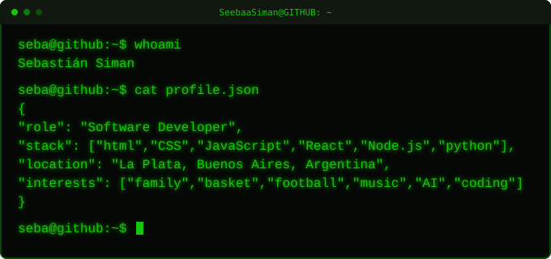

 

  

  

  

  
  
  

  <picture>
    <source
      media="(prefers-color-scheme: dark)"
      srcset="https://raw.githubusercontent.com/SeebaaSiman/SeebaaSiman/output/galaga-contribution-graph-dark.svg"
    />
    <source
      media="(prefers-color-scheme: light)"
      srcset="https://raw.githubusercontent.com/SeebaaSiman/SeebaaSiman/output/galaga-contribution-graph.svg"
    />
    
  </picture>

  Generated with
    <a href="https://github.com/abozanona/pacman-contribution-graph">
      Contribution Graph Games
    </a>
  

